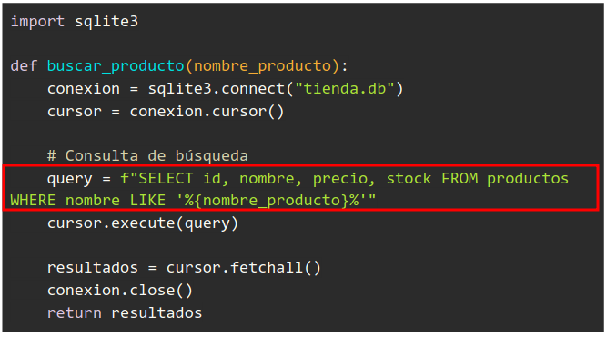
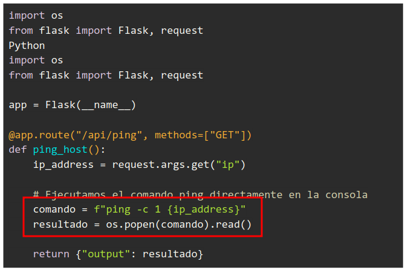
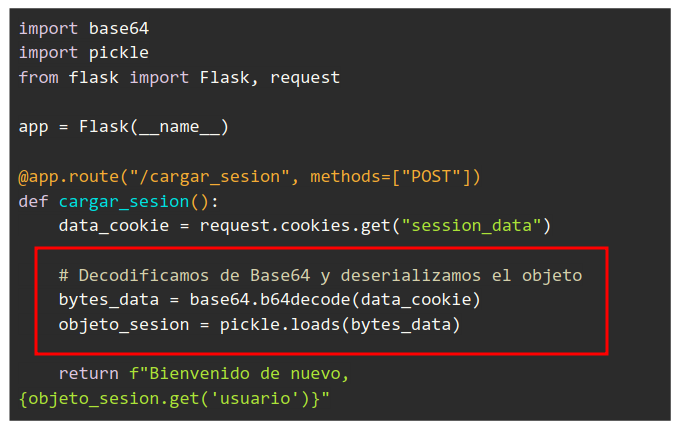

# Actividad 1.4: Vulnerabilidades, lenguajes de alto nivel.

__Autor:__ Pedro Martín Escuela <br>
__Asignatura:__ Puesta en producción Segura

## Introducción

A continuación se presentan 4 __fragmentos de código__ pertenecientes a distintos __servicios de una aplicación web__ en _Python_. Cada fragmento contiene una __vulnerabilidad crítica__ de
seguridad.

Para cada caso debes:

1. Identificar la __vulnerabilidad__ presente en el código.
2. Explicar el __impacto__ (qué podría lograr un atacante explotándola).
3. Proponer el __código corregido__ resolviendo el fallo de seguridad.

## Caso 1: Servicio de Búsqueda de Productos

El siguiente módulo de una __API REST__ permite __buscar productos__ en la base de datos según el __nombre__ proporcionado por el usuario.

__Vulnerabilidad:__ _SQL injection_.

__Impacto:__ Se puede modificar el valor de `nombre_producto` para que continue la sentencia sql como se desee. De esta forma, el atacante podría obtener acceso completo a la BBDD, desde obtener la información que quiera, hasta poder modificarla como quiera.

<center>
    
</center>

__Código corregido:__ 

Hay dos formas de solucionar esta vulnerabilidad. <br>
La primera es pasar el valor dentro de una __tupla__ como __segundo argumento__:

```py
...
# Usamos el marcador de posición '?'
query = "SELECT id, nombre, precio, stock FROM productos WHERE nombre LIKE ?"

# Agregamos los comodines '%' directamente al valor que se va a buscar
termino_busqueda = f"%{nombre_producto}%"

# Pasamos el valor dentro de una tupla como segundo argumento
cursor.execute(query, (termino_busqueda,))
...
```

Y la segunda sería hacer uso de algún __ORM__, el cual permite obtener información de la __BBDD__ mediante funciones seguras, que no mandan texto SQL puro al solicitar información.

# Caso 2: Herramienta de Diagnóstico de Red

Un __panel de administración__ permite a los ingenieros de soporte verificar si un servidor o IP responde mediante un comando ping.

__Vulnerabilidad:__ _OS Command Injection_.

__Impacto:__ Al mandar por comandos una concatenación de un string con una variable que se toma del request, el atacante puede ejecutar comandos en el servidor usando caracteres como `;` o `&&` para seguir ejecutando comandos segun quiera. Desde robarte datos, hasta cifrarte el disco duro o borrártelo.

<center>
    
</center>

__Código corregido:__ 

Podemos ajustar varias partes del código. <br>
Para empezar, se debe comprobar que la ip obtenida del request, es una __ip__ verdadera, con la librería `ipaddress`:

```py
try:
    ipaddress.ip_address(ip_address)
except (ValueError, TypeError):
```

Luego también podemos realizar una segura usando una lista de argumentos en vez del `os.popen()` de antes:

```py
...
try:
    resultado = subprocess.run(
        ["ping", "-c", "1", ip_address],
        capture_output=True,
        text=True,
        timeout=5
    )
    return {"output": resultado.stdout}
...
```

De esta forma, aun que la ip no hubiera sido validada, no se podrían concatenar comandos, ya que simplemente se lanzaría un ping, con las flag `-c` y `1` y el valor de ip_adress.

## Caso 3: Restauración de Sesiones e Historial

Para guardar la __sesión del usuario__ de forma rápida, la aplicación guarda la __sesión serializada__ y la __lee__ cuando el usuario regresa.

__Vulnerabilidad:__ _Deserialización Insegura_ y _Ejecución Remota de Código (RCE)_

__Impacto:__ La función `pickle.loads()` procesa datos serializados que provienen directamente de una cookie (__session_data__), la cual puede ser __manipulada libremente__ por cualquier usuario al inspeccionar la página y consultar el almacenamiento. 

También, en _Python_ un atacante puede crear un payload malicioso usando el método `__reduce__` de una clase para obligar al servidor a __ejecutar comandos del sistema__ operativo en cuanto el método `pickle.loads()` sea invocado.

<center>
    
</center>

__Código corregido:__

La librería de __Flask__ ya incluye un sistema de sesiones seguro que guarda los datos en una cookie __cifrada/firmada__ criptográficamente en el navegador del usuario utilizando `itsdangerous` (una biblioteca oficial de Python diseñada para enviar datos de forma segura a través de entornos en los que no confías). Por detrás viaja un formato similar a __JSON__ y es completamente inmune a ataques de __Ejecución Remota__.

```py
from flask import Flask, request, session

app = Flask(__name__)
# Es obligatorio definir una clave secreta firmar las cookies
app.secret_key = "UNA_CLAVE_SECRETA_DE_PRODUCCION"

@app.route("/cargar_sesion", methods=["POST"])
def cargar_sesion():
    # Flask maneja la cookie 'session' de manera segura por ti de forma nativa
    usuario = session.get("usuario")
    
    if not usuario:
        return "No hay sesión activa", 401
        
    return f"Bienvenido de nuevo, {usuario}"
```

## Caso 4: Descarga de Facturas y Documentos

Los usuarios autenticados pueden descargar sus recibos desde el área de clientes introduciendo el identificador de la factura. 

```py
from flask import Flask, request, jsonify, send_file
import sqlite3

app = Flask(__name__)
@app.route("/facturas/descargar", methods=["GET"])
def descargar_factura():
    factura_id = request.args.get("id")

    # Buscamos la factura parametrizada
    conn = sqlite3.connect("sistema.db")
    cursor = conn.cursor()
    cursor.execute("SELECT ruta_archivo FROM facturas WHERE id= ?", (factura_id,))
    factura = cursor.fetchone()
    conn.close()

    if factura:
        return send_file(factura[0], as_attachment=True)

    return jsonify({"error": "Factura no encontrada"}), 404
```

__Vulnerabilidad:__ _Path Traversal_.

__Impacto:__ Un atacante puede registrar una factura con una ruta maliciosa, o si la lógica interna del sistema permite manipular ese campo, se podrían descargar archivos sensibles del servidor.

__Código corregido:__ deberíamos restringir las descargas a un directorio específico utilizando `os.path`.

```py
import os
from flask import Flask, request, jsonify, send_from_directory
import sqlite3

app = Flask(__name__)
# Definimos el directorio seguro de facturas.
FACTURAS_DIR = os.path.abspath("ruta/segura/facturas")

@app.route("/facturas/descargar", methods=["GET"])
def descargar_factura():
    factura_id = request.args.get("id")

    if not factura_id:
        return jsonify({"error": "ID requerido"}), 400

    conn = sqlite3.connect("sistema.db")
    cursor = conn.cursor()
    cursor.execute("SELECT ruta_archivo FROM facturas WHERE id = ?", (factura_id,))
    factura = cursor.fetchone()
    conn.close()

    if factura:
        # Extraemos solo el nombre del archivo
        nombre_archivo = os.path.basename(factura[0])
        
        try:
            # Y guardamos en el directorio seguro
            return send_from_directory(FACTURAS_DIR, nombre_archivo, as_attachment=True)
        except FileNotFoundError:
            return jsonify({"error": "Archivo físico no encontrado"}), 404

    return jsonify({"error": "Factura no encontrada"}), 404
```

Esta corrección es bastante específica, si tuvieramos más opciones de directorios, habría que manejarlas.