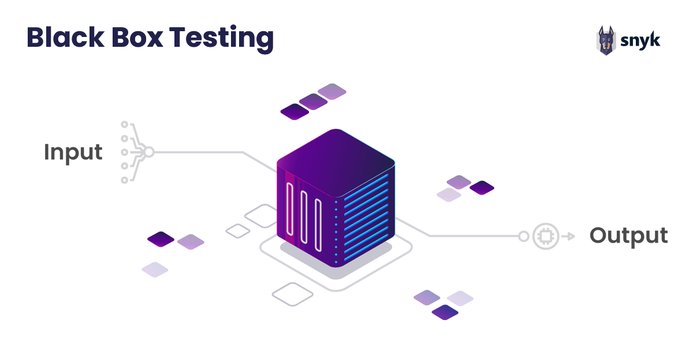

# Actividad 1.5 - Ejercicio de caja negra: validación de contraseña

__Autor:__ Pedro Martín Escuela  
__Asignatura:__ Puesta en producción segura

    

## Introducción:

Un formulario de registro exige que la contraseña cumpla estas reglas:

- Longitud entre 8 y 16 caracteres (ambos inclusive) (`8 =< longitud <= 16`)
- Debe contener al menos una letra mayúscula y un número

__Tareas:__

- Identifica las particiones de equivalencia (válidas e inválidas) para la longitud y para el contenido.

- Aplica el análisis de valores límite sobre la longitud.

- Elabora una tabla con al menos 8 casos de prueba con el formato: Entrada | Resultado esperado | Técnica aplicada.

### Particion de Equivalencia

| Partición | Rango | Tipo | Representante |
|-----------|-------|------|---------------|
| P1        | menor de 8 caracteres | Inválida | __abcde__ (5 ch) |
| P2        | de 8 a 16 caracteres | Iválida | __abcdefghij__ (10 ch) |
| P3        | de 8 a 16 caracteres   con mínimo 1 mayúscula | Inválida | __abCdefghij__ (10 ch, 1 mayus)
| P4        | de 8 a 16 caracteres   con mínimo 1 mayúscula   y mínimo 1 número | Válida | __abCdefghij5__ (10 ch, 1 mayus, 1 num)
| P5        | mayor de 16 caracteres | Inválida | __abcdefghijklmnopqr__ (18ch) |

### Análisis de valores límite

| Valor | Resultado esperado | Por qué |
|:-------:|--------------------|---------|
| 7 | Rechazado | Debajo del límite inferior|
| 8 | Aceptado | Es el límite inferior |
| 12 | Aceptado | Está entre el límite inferior y superior |
| 15 | Aceptado | Está justo debajo del límite superior |
| 16 | Aceptado | Es el límite superior |
| 17 | Rechazado | Por encima del límite superior |

### Casos de Prueba

| Entrada | Resultado esperado | Técnica aplicada |
|---------|--------------------|------------------|
| abCdefghij5 | Aceptada | Partición de equivalencia válida |
| 8374950A | Aceptada | Partición de equivalencia válida |
| Abcdef2 | Rechazada | Analisis de valor límite   (7 caracteres) |
| Abcdefghijklmnopq1 | Rechazada | Análisis de valor límite   (18 caracteres)|
| abcdefg | Rechazada | Partición de equivalencia inválida   (Sin número) |
| abcdefg1 | Rechazada | Partición de equivalencia inválida   (Sin mayúscula) |
| 234810923 | Rechazada | Partición de equivalencia inválida   (Sin letra) |
| `"Vacío"` | Rechazada | El campo es obligatorio |