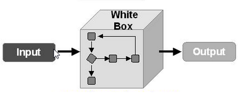
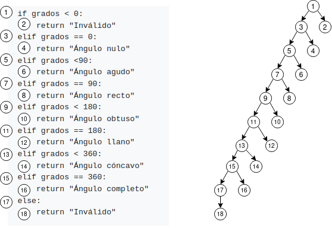

# Actividad 1.6 - Ejercicio de caja blanca: clasificación de ángulos

__Autor__: Pedro Martín Escuela <br>
__Asignatura__: Puesta en Producción Segura

<center>
    
</center>

## Introducción

Dado el siguiente código en Python:

```py
def clasificar(grados):

if grados < 0:  
    return "Inválido"  
elif grados == 0:  
    return "Ángulo nulo"  
elif grados <90:  
    return "Ángulo agudo"  
elif grados == 90:  
    return "Ángulo recto"  
elif grados < 180:  
    return "Ángulo obtuso"  
elif grados == 180:  
    return "Ángulo llano"  
elif grados < 360:  
    return "Ángulo cóncavo"  
elif grados == 360:  
    return "Ángulo completo"  
else:  
    return "Inválido"
```

Tareas:

- Dibuja el grafo de flujo del programa.

- Calcula la complejidad ciclomática V(G).

- Define el conjunto de caminos independientes.

- Diseña un caso de prueba (valores de grados y resultado esperado) para cada camino y comprueba que se alcanza una cobertura del 100 % de decisiones.

## Gráfo de Flujo del Programa

<center>
    
</center>

La complejidad Ciclomática V(G) se calcula con `V(G) = Aristas − Nodos + 2`. En este caso:

V(G) = 17 - (18 + 2) = - 3

## Casos de Prueba y Caminos Independientes

| Caso de Prueba | Camino | Nodos Recorridos | Entrada | Resultado Esperado | Condición Evaluada como Verdadera |
|:--------------:|:------:|------------------|---------|--------------------|-----------------------------------|
| CP1 | C1 | 1 -> 2 | -5 | Inválido | grados < 0 |
| CP2 | C2 | 1 -> -> 3 -> 4 | 0 | Ángulo nulo | grados == 0 |
| CP3 | C3 | 1 -> 3 -> 5 -> 6 | 34 | Ángulo agudo | grados < 90 | 
| CP4 | C4 | 1 -> 3 -> 5 -> 7 -> 8 | 90 | Ángulo recto | grados == 90 |
| CP5 | C5 | 1 -> 3 -> 5 -> 7 -> 9 -> 10 | 91 | Ángulo obtuso | grados < 180 |
| CP6 | C6 | 1 -> 3 -> 5 -> 7 -> 9 -> 11 -> 12 | 180 | Ángulo llano | gracos == 180 |
| CP7 | C7 | 1 -> 3 -> 5 -> 7 -> 9 -> 11 -> 13 -> 14 | 340 | Ángulo cóncavo | grados < 360 |
| CP8 | C8 | 1 -> 3 -> 5 -> 7 -> 9 -> 11 -> 13 -> 15 -> 16  | 360 | Ángulo completo | grados == 360 |
| CP9 | C9 | 1 -> 3 -> 5 -> 7 -> 9 -> 11 -> 13 -> 15 -> 17 -> 18 | 400 | Inválido | else (opción final de descarte) |